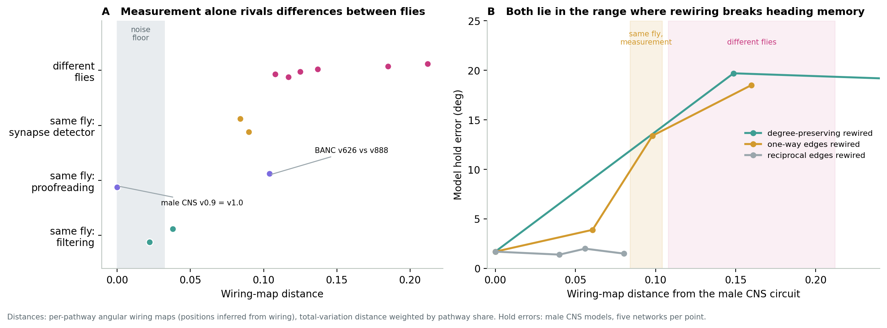

# ChessFly

**Reconstruction differences rival individual differences in the fly compass connectome and break trained circuit models**

Md Ali Ashraf Yad · Wrocław University of Science and Technology
Paper: arXiv:XXXX.XXXXX (link added after posting) · Preregistration: [doi:10.5281/zenodo.23382486](https://doi.org/10.5281/zenodo.23382486)

<p align="center"></p>

## Summary

Neural network models are increasingly built from synapse-resolution connectomes, and the same circuit now exists in reconstructions from several animals and pipelines. We studied the *Drosophila* head-direction (compass) circuit in **nine versions**: four flies (male CNS, hemibrain, FlyWire, BANC) and five variants of the same fly that differ only in synapse filtering, proofreading or synapse detection.

- **Measurement rivals individuality.** Changing the synapse detector within one fly altered the circuit by more than half of the smallest difference between flies, on four distance measures.
- **Trained models are knife-edge ring attractors.** Networks trained on each wiring to hold a heading formed near-perfect continuous attractors, but a 1% change of all weights broke them.
- **Models do not transfer between connectomes, even of the same fly.** Refitting about thirty cell-type gains repaired only filtering-level differences; the remaining error tracked wiring distance, whatever its source.
- **Robustness has a price.** Training with noise traded precision for robustness and gave only partial transfer.
- **Real flies are not knife-edge.** In imaging data (DANDI 000289) the fly compass drifts gradually in darkness.

## Figures

| | |
| --- | --- |
| [Fig 1](new_study/figures/fig1_design.png) | Circuit, nine wiring versions, experiments |
| [Fig 2](new_study/figures/fig2_differences_one_scale.png) | All differences on one scale |
| [Fig 3](new_study/figures/fig3_ring_and_fragility.png) | Ring attractors and knife-edge fragility |
| [Fig 4](new_study/figures/fig4_transplant_tradeoff.png) | Transplants and the precision–robustness trade-off |
| [Fig 5](new_study/figures/fig5_transfer_by_source.png) | Transfer by source of difference; cell-type refit |
| [Fig 6](new_study/figures/fig6_fly_drift.png) | Compass drift in real flies |

## Repository layout

| Folder | Contents |
| --- | --- |
| [`new_study/`](new_study/) | Code, results, figures and networks for the paper (start here) |
| [`v1_chessfly/`](v1_chessfly/) | The earlier project: spiking fly reservoir, chess, null-wiring experiments (Phases 1–8), demos |

## Reproducing the paper

See [`new_study/README.md`](new_study/README.md) for the step-by-step pipeline. GPU steps run on a free Colab or Kaggle T4 (minutes to about an hour each); all analyses and figures run on a CPU from the saved result files.

## Data

Janelia FlyEM male CNS and hemibrain connectomes (neuPrint), FlyWire FAFB and BANC (FlyWire Codex), and E-PG imaging data from Basnak et al. 2025 (DANDI 000289). Please cite the original datasets.

## Citation

```bibtex
@article{yad2026reconstruction,
  title   = {Reconstruction differences rival individual differences in the fly compass connectome and break trained circuit models},
  author  = {Yad, Md Ali Ashraf},
  journal = {arXiv preprint arXiv:XXXX.XXXXX},
  year    = {2026}
}
```

## Earlier work

The project began as **ChessFly**: can the fly compass circuit, used as a neural network, learn chess? It could not, better than random wiring, and that result led to the question studied here. The full earlier project, with interactive demos ([3D mission](https://claude.ai/artifact/5cobwrSTvQWzB88KUtVBZe), [play against the fly](https://claude.ai/artifact/8gRB5DUGNV5WrG3kmYfL8s)), is in [`v1_chessfly/`](v1_chessfly/).
